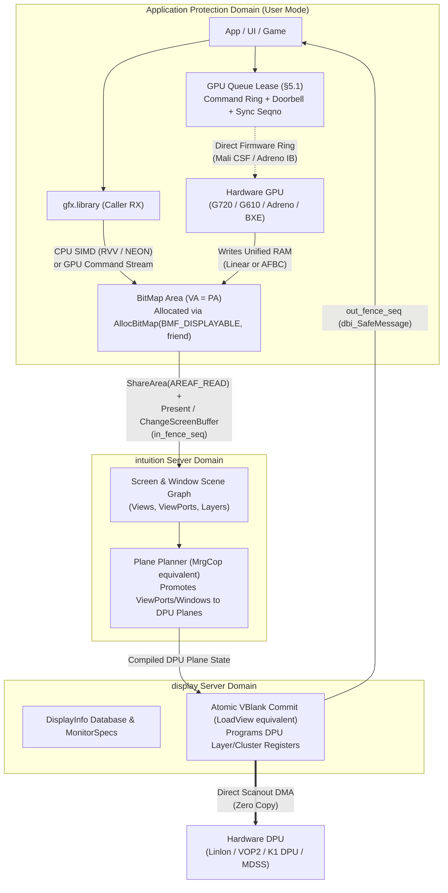

# 16. Retargetable Graphics (RTG) for modern DPUs and GPUs (`display`, `gfx.library`, `intuition`)

**Status: proposed (2026-10-20).** Builds on the single address space ([§3](03-memory.md)), zero-copy IPC rings ([§4](04-ipc.md)), coprocessor queue leases ([§5](05-coprocessors.md)), driver model ([§11](11-driver-model.md)), crash containment ([§12](12-let-it-crash.md)) and Workbench architecture ([§13](13-workbench.md)).

When people say "Amiga RTG" today, they usually mean the mid-to-late-1990s third-party stacks—**EGS**, **CyberGraphX (CGX)** and **Picasso96 (P96)**—written to graft Zorro II/III PC SVGA chips (Tseng ET4000, Cirrus GD54xx, S3 Virge) onto AmigaOS 3.x. That third-party drift solved a 1995 problem that **does not exist on Planar's hardware**, and copying its assumptions would actively fight Planar's single address space, modern multi-plane Display Processing Units (DPUs) and user-mode GPU queue leases.

Instead, Planar goes back to **Commodore's original 1990–1993 internal RTG trajectory** across `graphics.library` V36–V40 (Jim Mackraz, Chris Green, Spence Shanson, Bart Whitebook, Dale Luck) and the **AAA / Hombre** architecture notes (Ed Hepler), and scales those primitives up to 64-bit unified-memory SoCs.

---

## 16.1 Commodore's original RTG design vs. the 1995 third-party drift

### What Commodore actually built and specified (V36–V40 & AAA/Hombre, 1990–1993)

Before Commodore's 1994 collapse, its software and VLSI teams had already laid down four architectural pillars for Retargetable Graphics:

1. **The Display Info Database and `MonitorSpec` (V36, Jim Mackraz)**
   - Replaced hardcoded NTSC/PAL assumptions with a runtime hardware capability database (`DisplayInfoDataBase`: `FindDisplayInfo`, `GetDisplayInfoData`, `DimensionInfo`, `MonitorInfo`) keyed by 32-bit `ModeID`s.
   - Introduced `struct MonitorSpec` (`graphics/monitor.h`), `ViewExtra` and `ViewPortExtra` (bound via `GfxNew` and `GfxAssociate`), attaching a per-monitor driver vector table (`VecTable` / `VecInfo`) to compile abstract views into monitor-specific hardware state.
2. **Separation of Declarative Scene Graph, Compilation and VBlank Commit (`MakeVPort` → `MrgCop` → `LoadView`)**
   - In Commodore's model, `View` (the whole display output) and stacked/split `ViewPort`s (independent hardware composition layers with their own `RasInfo` surface, offset, scaling and colour map) were **not** flattened by the CPU into one giant frame buffer.
   - Instead, `MakeVPort()` compiled each `ViewPort`'s parameters through its `VecTable`, `MrgCop()` merged those per-layer hardware instructions into a frame program, and `LoadView()` atomically latched the compiled state at the next vertical blanking interval.
3. **Opaque Surface Allocation with Hardware Affinity (`AllocBitMap` & `GetBitMapAttr`, V39, Chris Green)**
   - V39 introduced `AllocBitMap(sizex, sizey, depth, flags, friend_bitmap)` and `GetBitMapAttr()`.
   - Instead of applications manually allocating bitplanes in Chip RAM, `BMF_DISPLAYABLE` declared that a surface must be directly scannable by a display controller, `BMF_MINPLANES` / `BMF_STANDARD` described layout constraints, and **`friend_bitmap`** let the allocator match the memory zone, alignment, pixel packing and hardware constraints of a target screen or device without exposing internal struct fields.
4. **Asynchronous Message-Port Flipping (`AllocScreenBuffer` / `ChangeScreenBuffer`, V39) and Command Queues**
   - V39 Intuition introduced `ScreenBuffer` and `DBufInfo`, which synchronized Tear-Free flips using two Exec message ports: `dbi_SafeMessage` (replied when old scanout left the buffer, making it safe to draw into) and `dbi_DispMessage` (replied when the new buffer actually hit the glass at vblank).
   - Both the classic Blitter (`QBlit` asynchronous blitter node queues) and Ed Hepler's **Hombre** (`Nathaniel` DMA controller + `Natalie` display/3D processor) treated graphics accelerators as **asynchronous ring/command-list processors** operating over shared memory, not CPU-polled register I/O ports.

### How CyberGraphX and Picasso96 drifted—and why that drift fails on Planar

Because third-party Zorro II/III graphics cards sat across an asymmetric 16/32-bit expansion bus with isolated board VRAM and primitive 2D register blitters, CGX and P96 made four compromises that are **anti-patterns** on modern SoCs:

| 1995 Third-Party Drift (CGX / P96) | Why it existed in 1995 | Why Planar rejects it |
|---|---|---|
| **`SetFunction()` ROM patching** (`cybergraphics.library` / `rtg.library` hijacking 40+ `graphics.library` vectors at boot) | Kickstart 3.0/3.1 was in mask ROM and couldn't be recompiled by board vendors. | Planar owns `gfx.library`, `intuition` and `display` cleanly from source. Vector hijacking violates W^X (P1) and muddies layer boundaries. |
| **`LockBitMapTagList()` / `UnLockBitMap()`** explicit surface locking & software board-VRAM migration (`boardinfo`) | Zorro bus reads were excruciatingly slow, and banked/segmented SVGA apertures couldn't be left mapped or accessed concurrently by the 2D blitter. | Planar runs on **unified-memory 64-bit SoCs** with a Single Address Space (P2). Every surface is a permanent `Area` with one universal pointer (`VA = PA`). Explicit lock/copy/unlock migration adds needless traps and copies. |
| **Synchronous 2D register-blitter hooks** (`BlitRect`, `FillRect`, `InvertRect` inside driver `BoardInfo` callbacks) | 1994 SVGA chips had fixed-function 2D register engines poked one rectangle at a time by the CPU. | Modern GPUs (Mali Valhall/Immortalis CSF, Adreno 690) have **no fixed-function 2D register blitter**. Submitting a single rectangle via a kernel/server call costs more than drawing it with CPU SIMD (RVV 1.0 / NEON) or batching a command buffer into a §5.1 **GPU queue lease**. |
| **Collapsing `View`/`ViewPort` into a single flat chunky framebuffer** | 1990s SVGA CRTCs had only one scanout plane plus a tiny 64×64 hardware cursor. | Modern SoC DPUs (CIX Linlon, RK3588 VOP2, K1 DPU, Qualcomm MDSS) are **multi-plane hardware compositors** with 4–8 independent overlay layers, hardware scalers, YUV/RGB colour-space converters and AFBC decompressors. Flattening everything into one framebuffer wastes memory bandwidth and power. |

---

## 16.2 The core insight: Modern DPUs are the Copper; Modern GPUs are Queue Leases

Commodore's original split between **Display Scanout Composition (`View`/`ViewPort`/Copper)** and **Rendering/Blitting (`RastPort`/Blitter)** maps directly onto the hardware split present on every modern Arm and RISC-V SoC:



1. **The DPU is the modern Copper (`display` server)**
   Every target SoC has a dedicated Display Processing Unit separate from the 3D GPU:
   - **CIX P1**: Arm Linlon DPU (`komeda` lineage; dual pipelines, multiple layer streams with hardware rotation, scaling, alpha blending, YUV→RGB and AFBC 1.2 scanout).
   - **RK3588**: Rockchip VOP2 (Video Output Processor v2; up to 4 video ports and 8 cluster/esmart overlay planes with AFBC and 4K/8K scanout).
   - **SpacemiT K1 (RV2)**: K1 DPU (multi-layer RDMA + composer channels with hardware cursor and HDMI/DSI output).
   - **Qualcomm SC8280XP (Q8B)**: Snapdragon MDSS / DPU (vig/dma SSPP pipes, layer mixers, DSPP and DisplayPort/eDP interfaces).
   
   Just like the Amiga Copper executing a merged `ViewPort` instruction list every vblank, these DPUs fetch from **multiple independent `BitMap` `Area`s in unified RAM simultaneously**, scale and blend them in hardware on the scanout pixel clock, and latch new register configurations atomically on vertical blank.

2. **The GPU is a user-mode Coprocessor (`gpu-*` server + `gfx.library`)**
   The 3D/compute GPU never touches display timings or connectors. It reads and writes `BitMap` `Area`s in unified memory through a [§5.1 Queue Lease](05-coprocessors.md#51-the-abstraction), synchronized with the DPU through 64-bit memory-resident sequence numbers (`SyncSeq`).

---

## 16.3 Updating Commodore's four RTG pillars for Planar

### Pillar 1: `BitMap` as a Universal-Pointer `Area` Descriptor (`AllocBitMap` & `GetBitMapAttr`)

In Planar, a `BitMap` is no longer a 68k struct with 8 `PLANEPTR` pointers into 2 MiB Chip RAM. It is a lightweight, immutable descriptor around a Planar **`Area`** (`include/planar/`) whose base address is identical for the CPU, the GPU and the DPU (P2):

```c
typedef struct BitMap {
    AreaHandle  bm_Area;          // Underlying kernel Area handle (ShareArea-ready)
    const void *bm_BaseAddr;      // Universal pointer (VA == PA in identity SAS)
    uint32_t    bm_Width;         // Width in pixels
    uint32_t    bm_Height;        // Height in pixels
    uint32_t    bm_BytesPerRow;   // Pitch / row stride in bytes (64-byte aligned)
    uint32_t    bm_PixelFormat;   // PIXFMT_ARGB8888, PIXFMT_XRGB8888, PIXFMT_RGB10A2, PIXFMT_NV12...
    uint64_t    bm_Modifier;      // MOD_LINEAR, MOD_AFBC_16x16, MOD_AFBC_SPARSE, MOD_TILED...
    uint32_t    bm_Flags;         // BMF_DISPLAYABLE, BMF_CLEAR, BMF_GPU_RENDER, BMF_COHERENT...
    uint32_t    bm_ColorSpace;    // CS_SRGB, CS_BT709, CS_BT2020_PQ (HDR10)
} BitMap;
```

- **`AllocBitMap(width, height, pixel_format, flags, friend_bitmap)`**:
  - When `BMF_DISPLAYABLE` is set, `AllocBitMap` consults the `friend_bitmap` (or the target `MonitorSpec` / `Screen`) to satisfy **hardware scanout constraints** automatically:
    - **Address ceiling**: On the Q8B (SC8280XP), MDSS scanout must reside in contiguous physical memory below 4 GiB ([§1.2](01-spec-review.md#12-memory-model-paper-3)); `AllocBitMap` selects the `DMA32` PMM zone automatically.
    - **Cache attributes**: Selects Write-Back (`WB`), Write-Combining (`WC`) or Non-Cacheable (`NC`) per the board's DPU/GPU coherency matrix ([§5.2](05-coprocessors.md#52-cache-attributes)).
    - **Row pitch and tile alignment**: Enforces the DPU's required row stride (e.g. 64-byte or 128-byte pitch alignment, or AFBC superblock header alignment).
  - **No `LockBitMap` / `UnLockBitMap`**: For `MOD_LINEAR` bitmaps, `bm_BaseAddr` is directly readable and writable by the owning process at all times. Cache maintenance (on non-coherent DPUs like the K1) is triggered automatically at presentation (`PresentWindow` / `ChangeScreenBuffer`) over the dirty damage rectangles, not via manual lock/unlock pairs.
- **`GetBitMapAttr(bm, attr)`**:
  - Preserves Commodore's V39 query pattern (`BMA_WIDTH`, `BMA_HEIGHT`, `BMA_PIXELFORMAT`, `BMA_BYTESPERROW`, `BMA_MODIFIER`, `BMA_FLAGS`, `BMA_BASEADDR`) for clean introspection across library boundaries.

---

### Pillar 2: The Display Database (`DisplayInfoDataBase` & `MonitorSpec`)

Rather than Linux DRM/KMS's maze of mutable kernel object IDs (CRTCs, encoders, connectors, blobs) exposed via dozens of `ioctl`s, Planar updates Commodore's V36 **Display Database** as a **read-only shared `Area`** published by the `display` server:

- **Structured 32-bit `ModeID`**:
  ```
  ┌──────────────┬──────────────┬────────────────────────┐
  │ 31..24 (8b)  │ 23..16 (8b)  │ 15..0 (16b)            │
  │ Monitor /    │ Pipeline /   │ Timing & Pixel Mode    │
  │ Connector ID │ DPU Index    │ Index (EDID / Fixed)   │
  └──────────────┴──────────────┴────────────────────────┘
  ```
- **Zero-trap queries (`FindDisplayInfo`, `NextDisplayInfo`, `GetDisplayInfoData`)**:
  Because the `DisplayInfoDataBase` lives in a read-only shared `Area` updated via a seqlock when a monitor is hot-plugged (HDMI/DisplayPort HPD), any process can enumerate monitors, EDID modes, VRR (Variable Refresh Rate) ranges, HDR capabilities, and supported DPU plane formats/modifiers in user mode with **zero kernel traps or IPC round trips**.
- **`MonitorSpec` (`display` driver contract)**:
  Inside the `display` server, each physical output pipeline is backed by a `MonitorSpec` with a hardware-specific `VecTable` of 5 operations:
  1. `ms_ProbeModes()` — Reads EDID/DisplayID over DDC/AUX and populates `DisplayInfo` records.
  2. `ms_ValidateView()` — Checks whether a set of `ViewPort` planes fits the DPU's layer count, scaler units, clock budget and AFBC decoders (`MakeVPort` / `MrgCop` validation).
  3. `ms_CompileView()` — Translates validated `ViewPort` descriptors into a ready-to-latch DPU register command block.
  4. `ms_LoadView()` — Commits the compiled register block for atomic latching on the next vblank.
  5. `ms_SetCursor()` — Fast-path update of the hardware cursor plane $(x, y)$ and hotspot.

---

### Pillar 3: `View`, `ViewPort` and `MrgCop` as Hardware DPU Plane Composition

Commodore's most distinctive graphics idea was that **screens and split viewports are composed by the display processor during scanout**, not copied into a backing store unless necessary.

Planar maps Commodore's hierarchy directly onto modern DPU hardware planes:

| Commodore Original (V36–V39) | Planar Modern DPU Equivalent | Hardware Realisation (Linlon / VOP2 / K1 / MDSS) |
|---|---|---|
| **`struct View`** (`ViewExtra`) | Complete multi-monitor or single-output scanout configuration | One DPU display pipeline / CRTC output frame state. |
| **`struct ViewPort`** (`ViewPortExtra`) | A hardware composition plane (`DpuPlane`) with source `BitMap`, source crop (`RasInfo`), destination rectangle (`DisplayClip`), $z$-order, alpha mode, and colour space | One hardware DPU layer / SSPP / cluster plane. |
| **`MakeVPort(view, vp)`** | Validates a single `ViewPort` against DPU plane capabilities (format, AFBC modifier, scaling ratio, 4 GiB DMA limit) and precomputes its plane register words | Per-plane register block preparation in `intuition` / `display`. |
| **`MrgCop(view)`** | **Plane allocation & fallback solver**: assigns top-level screens, fullscreen/video/3D windows and the cursor to hardware DPU planes; marks any remaining overlapping/translucent windows for composition into the primary plane | Hybrid DPU-plane + compositor planner ([§13.1](13-workbench.md#131-architecture-and-data-path), **VQ31**). |
| **`LoadView(view)`** | **Atomic VBlank Commit**: writes the compiled DPU plane table and arms the DPU's flush/commit bit for the next vertical blank | Linlon `LPU_FLUSH`, VOP2 `OVL_CFG_DONE`, K1 DPU commit, MDSS `CTL_FLUSH`. |
| **Screen-dragging** (Copper vertical split) | Dragging a Screen vertically adjusts its `ViewPort` destination $y$-offset (`DpuPlane.dst_y`) in the DPU overlay mixer at 60/120 Hz | **Zero pixel blits**: hardware DPU planes slide over one another at full refresh rate! |

> **Why this matters:** Classic Amiga screen dragging—pulling the top screen down to reveal another screen running live at a different resolution or colour format behind it—was trivial on the Copper and awkward on 1995 SVGA RTG cards (which had to software-blit or switch CRTC modes). On modern multi-plane DPUs (Linlon, VOP2, K1 DPU, MDSS), **true zero-copy hardware screen dragging returns natively**, because each screen is simply a hardware DPU overlay plane with a vertical offset and clip rectangle.

---

### Pillar 4: Asynchronous Presentation & Explicit Sync (`ChangeScreenBuffer` + `SyncSeq`)

Commodore's V39 `ScreenBuffer` / `DBufInfo` replaced `WaitTOF()` spin-loops with asynchronous message-port notifications (`dbi_SafeMessage` and `dbi_DispMessage`). Planar fuses this with the 64-bit sequence-number sync objects of [§5.1 Queue Leases](05-coprocessors.md#51-the-abstraction):

```
App (GPU Queue Lease)               intuition / display Server             Hardware DPU
─────────────────────               ──────────────────────────             ────────────
1. Submit GPU commands to ring
   (signals gpu_sync.seq = N)
2. Ring GPU hardware doorbell
3. PresentWindow / ChangeScreenBuffer ──▶ 4. Wait/chain on gpu_sync.seq >= N
   (area_handle, damage,                  5. Program DPU plane scanout addr
    in_fence = &gpu_sync, seq = N)           & arm atomic vblank commit ──▶ 6. VBlank latches buffer B
                                          7. Buffer A leaves scanout     ◀──    Scanout leaves buffer A
8. App wakes via WaitAddr / ring  ◀────── 8. Advance vblank_sync.seq = M
   (dbi_SafeMessage equivalent)              (Buffer A safe to reuse)
```

1. **In-fence (`in_sync_area`, `in_seq`)**: When an application renders via a GPU queue lease, it does **not** block waiting for the GPU to finish before calling `PresentWindow` or `ChangeScreenBuffer`. It passes the GPU sync object's reference and target sequence number $N$.
2. **Out-fence & VBlank Counter (`vblank_seq`, `safe_seq`)**: Each screen/window connection shares a cache-line sync state containing:
   - `disp_seq` (*V39 `dbi_DispMessage`*): incremented at the exact vblank when buffer *B* hits scanout, stamped with the hardware `cycle_stamp` (`CNTVCT_EL0` / `rdtime`) so audio (`AudioConductor`, [§15.6](15-audio-dsp.md#156-realtimelibrary-conductor-and-event-routing)) and video stay locked to the microsecond.
   - `safe_seq` (*V39 `dbi_SafeMessage`*): incremented when the DPU latches the *subsequent* flip and releases buffer *A* for reuse by the application.
3. **Zero traps in steady state**: If the application checks `safe_seq` in shared memory and sees its back buffer is already free, it immediately starts recording the next frame's commands without a single kernel trap (P4). It calls `WaitAddr` only when it gets ahead of the display refresh rate.

---

## 16.4 Modern `gfx.library`: Hybrid SIMD + GPU Queue-Lease Rendering

In Commodore's design, `graphics.library` provided higher-level 2D drawing primitives (`BltBitMap`, `RectFill`, `WritePixelArray8`, `Text`, polygons) over a `RastPort` (a rendering context bound to a `BitMap`, clipping `Layer`, pen state and font).

On Planar, `gfx.library` runs entirely in the **caller's protection domain** (shared `RX` code, caller-owned state, zero IPC for drawing) and executes through a **dual-provider backend** selected per `RastPort`:

| Backend | When used | How it works |
|---|---|---|
| **`GFX_BACKEND_SIMD`** (Always available, V4+) | Default for UI widgets (`ui.library`), `Shell`, icons, small damage rects, and boards before GPU bring-up | Pure C23 + RVV 1.0 (RV2) / NEON & SVE2 (CIX, RK3588, Q8B) tiled scanline rasteriser writing directly into the caller's `BitMap` `Area`. Zero command-submission overhead for small UI updates. |
| **`GFX_BACKEND_LEASE`** (Hardware GPU, V5+) | Opt-in or automatic for large surfaces, high-DPI path composition, shaders, 3D views and AFBC buffers | Encodes `RastPort` operations and custom compute/graphics shaders directly into the process's **§5.1 GPU Queue Lease** ring (Mali CSF user queue on G720/G610, IB ring on Adreno 690) and rings the doorbell in user mode. |

### Clean-slate 2D/Vector Primitives (Replacing Planar Bitplane Ops)

We drop legacy bitplane-specific entry points (`BltTemplate` planar masks, `AreaEnd`Chip-RAM workspace scratchpads, `WriteChunkyPixels` planar-conversion shims) and keep a clean, modern `RastPort` API:

- **Surface & Blit operations**:
  - `GfxRectFill(rp, x, y, w, h, color_or_brush)` — Solid, linear/radial gradient (`bg.backdrop.base`, `bar.screen.bg`), or bevel rect fill.
  - `GfxBlitBitMap(src_bm, sx, sy, dst_rp, dx, dy, w, h, blend_mode)` — replaces minterms (`0xC0`, etc.) with Porter-Duff alpha compositing (`BLEND_SRC`, `BLEND_SRC_OVER`, `BLEND_ADD`, `BLEND_MULTIPLY`).
- **Resolution-independent Vector Paths**:
  - `GfxBeginPath(rp)`, `GfxMoveTo`, `GfxLineTo`, `GfxCubicTo`, `GfxRoundRect`, `GfxStroke(rp, width)`, `GfxFill(rp)` — Analytic anti-aliased vector rasteriser (sharing the scanline coverage accumulator with `font.library`, [§14](14-font-engine.md)) for Planar's bevelled window chrome, isometric icons and procedural desktop backdrop ([§13.2](13-workbench.md#132-visual-design-system)).
- **Typography integration**:
  - `GfxDrawGlyphRun(rp, glyph_run, x, y, color)` — Composites `font.library` coverage masks (`A8` or `4×` subpixel phases, **VQ35**) using SIMD `over` blending with gamma-correct linear-light lut tables.
- **Direct Command Stream Access (`GfxObtainQueueLease`)**:
  - Applications doing 3D, custom compute or video decoding query their `RastPort` / `BitMap` format and submit native GPU command streams directly to their §5.1 Queue Lease, using `BitMap.bm_BaseAddr` directly in GPU descriptors (since the GPU MMU is programmed with **identity mappings** of the process's granted `Area`s, [§5.3](05-coprocessors.md#53-by-board)).

---

## 16.5 Fault Tolerance: "Let It Crash" for Display and GPU

Applying [§11.4](11-driver-model.md#114-teardown-unbind-is-kill) and [§12](12-let-it-crash.md) to the RTG pipeline guarantees that neither a crashing 3D client nor a wedged GPU takes down the display:

1. **Client crash while its `BitMap` is actively scanned out by the DPU (`D2` quarantine)**
   - Suppose a fullscreen game or promoted window has its `BitMap` `Area` bound directly to a hardware DPU plane when the client process faults and dies.
   - If the kernel freed those physical pages immediately in step 5 of `ExitProcess`, the DPU would scan out reallocated memory (visual snow/data leak) or trigger an SMMU/bus fault.
   - **Rule:** When `intuition` or `display` binds a client `BitMap` `Area` to a hardware DPU plane, it holds a duplicated `AreaHandle` (`DupHandle`). When the client dies (`CONNF_CLIENT_GONE`), `intuition` removes the dead window/screen, programs the DPU to turn off that overlay plane (or switch back to the Workbench screen) on the next vblank, and **only closes its `AreaHandle` after the vblank flip completes**. The physical pages remain valid until scanout has provably moved off them.
2. **Client crash with a GPU Queue Lease in flight**
   - As specified in [§5.4](05-coprocessors.md#54-reclamation-and-faults), the `gpu-*` server terminates the client's Command Stream Group (CSG) on Mali CSF (or drains/resets the Adreno context), unmaps its GPU MMU stage-1 tables, and only then releases the lease-tied `Area`s from quarantine.
3. **`gpu-*` server crash vs. `display` server independence**
   - Because `display` (DPU scanout) and `gpu-*` (3D/compute queue leases) are **separate user-mode processes**, a GPU hang or `gpu-panthor` restart never drops the display signal. `intuition` and `Shell` seamlessly fall back to `GFX_BACKEND_SIMD` while `hwdb` resets and restarts the GPU server.

---

## 16.6 Hardware Mapping Across Target Boards

| Board / SoC | Display Controller (`display` server) | Hardware Planes & Formats | GPU (`gpu-*` server) | Memory & Coherency Notes |
|---|---|---|---|---|
| **QEMU** (`qemu-virt-rv64`, `qemu-virt-a64`) | `ramfb` / `virtio-gpu-2d` (or `bochs-display`) | 1 primary linear plane (`XRGB8888`) + software/virtio cursor | None (`GFX_BACKEND_SIMD` on RVV / NEON) | WB memory; `virtio-gpu` transfer/flush on dirty rect present. |
| **Orange Pi RV2** (SpacemiT K1) | **K1 DPU** (HDMI / DSI) | 4 RDMA overlay layers + hardware cursor; `ARGB8888`, `XRGB8888`, `RGB565`, `NV12` | IMG BXE-2-32 (server queue, **VQ17**); RVV 1.0 SIMD primary | `BMF_DISPLAYABLE` uses `WC`/`NC` or `WB` + `Zicbom` `cbo.clean` on dirty rects at `Present` ([§5.2](05-coprocessors.md#52-cache-attributes)). |
| **Orange Pi 6 Plus** (CIX P1 / Sky1) | **Arm Linlon DPU** (`komeda` architecture, DP / HDMI) | 2 pipelines × 4 layers + cursor; `ARGB8888`, `XRGB2101010`, `NV12`, **AFBC 1.2** (`16×16` superblocks) | **Immortalis-G720 MC10** (CSF hardware user queues, `gpu-panthor`) | SMMUv3 identity-mapped for both Linlon and G720. Zero-copy AFBC scanout directly from G720 render targets! |
| **Orange Pi 5 Plus** (Rockchip RK3588) | **Rockchip VOP2** (HDMI 2.1 / eDP / DP) | 4 video ports, up to 8 cluster/esmart planes + cursor; linear & **AFBC** | **Mali-G610 MP4** (CSF hardware user queues, `gpu-panthor`) | Per-block Rockchip IOMMU identity-mapped to process `Area`s. |
| **Radxa Dragon Q8B** (Qualcomm SC8280XP) | **Qualcomm MDSS / DPU** (eDP / DP) | Vig + DMA SSPP pipes, hardware scalers, cursor; linear & UBWC | **Adreno 690** (`gpu-msm` server queue over CP IB rings) | **Hard constraint ([§1.2](01-spec-review.md))**: `AllocBitMap(BMF_DISPLAYABLE)` allocates contiguous physical pages `< 4 GiB` (`DMA32`) matching UEFI's SMMU bypass aperture. |

---

## 16.7 Summary of API Lineage: Commodore V39 → Planar RTG

| Commodore V36–V40 Primitive | Role in Original Spec | Planar RTG Equivalent |
|---|---|---|
| `AllocBitMap(w, h, d, flags, friend)` | Abstract surface allocator with device affinity (`BMF_DISPLAYABLE`) | `AllocBitMap(w, h, fmt, flags, friend)` → allocates a universal-pointer `Area` with board-correct DMA zone, stride, cache attribute and modifier (`MOD_LINEAR` / `MOD_AFBC`). |
| `FreeBitMap(bm)` | Releases surface memory | `FreeBitMap(bm)` → closes the `AreaHandle` (quarantined by `display`/`gpu` until scanout and queues drain). |
| `GetBitMapAttr(bm, attr)` | Safe surface property query | `GetBitMapAttr(bm, attr)` → returns width, height, pitch, `PixelFormat`, `Modifier`, `AreaHandle` and universal `BaseAddr`. |
| `FindDisplayInfo` / `GetDisplayInfoData` | Runtime Display Info Database | Lockless read-only shared `Area` (`DisplayInfoDataBase`) published by `display` with EDID timings, HDR/VRR ranges and plane capabilities. |
| `MonitorSpec` + `VecTable` | Per-monitor hardware compilation hooks | User-mode `display` driver vtable (`ms_ProbeModes`, `ms_ValidateView`, `ms_CompileView`, `ms_LoadView`, `ms_SetCursor`). |
| `View` / `ViewPort` / `RasInfo` | Declarative multi-layer composition & screen-dragging graph | `DpuView` / `DpuPlane` descriptors mapping Screens and promoted Windows directly to hardware DPU overlay planes. |
| `MakeVPort` + `MrgCop` | Compiles and merges `ViewPort`s into a Copper list | Plane planner in `intuition` + `display`: assigns visible layers to DPU hardware planes and falls back to composition only when planes are exhausted. |
| `LoadView` | Latches new Copper list at vblank | Atomic DPU register commit latched on vertical blank. |
| `AllocScreenBuffer` / `ChangeScreenBuffer` (`DBufInfo`) | Tear-free flipping via `dbi_SafeMessage` & `dbi_DispMessage` ports | Zero-trap `PresentWindow` / `ChangeScreenBuffer` ring messages with 64-bit `in_fence` (GPU sync) and `disp_seq` / `safe_seq` (`WaitAddr` vblank sync). |
| `QBlit` / Copper / Hombre `Natalie` | Asynchronous coprocessor command queues | [§5.1 Queue Lease](05-coprocessors.md#51-the-abstraction) (`gpu-panthor`, `gpu-msm`) + `gfx.library` dual SIMD/GPU backend. |

---

## 16.8 Open Questions

- **VQ38 Compressed / Tiled Framebuffer Modifiers (`MOD_AFBC_16x16`, `MOD_UBWC`) vs. Linear-Only Surfaces in V5.**
  Both the CIX P1 (Immortalis-G720 + Linlon DPU) and RK3588 (Mali-G610 + VOP2) support **Arm Frame Buffer Compression (AFBC)** end-to-end: the GPU renders compressed 16×16 superblocks into memory and the DPU scans them out directly, cutting memory bandwidth by ~40–50%. However, CPU SIMD (`GFX_BACKEND_SIMD`) cannot cheaply draw single pixels into an AFBC buffer without a tile decoder/encoder. Should `AllocBitMap` default to `MOD_LINEAR` and reserve `MOD_AFBC_16x16` for explicit `BMF_GPU_RENDER | BMF_DISPLAYABLE` surfaces?
  *Leaning:* yes—`MOD_LINEAR` (`ARGB8888` / `XRGB8888`) is the universal baseline for all CPU SIMD and mixed surfaces, while `AllocBitMap` selects `MOD_AFBC_16x16` only when the caller sets `BMF_GPU_ONLY | BMF_DISPLAYABLE` on a `friend_bitmap` belonging to an AFBC-capable `MonitorSpec`.

- **VQ39 Hardware Screen Dragging and Multi-Screen DPU Plane Budgeting.**
  When two or more Intuition `Screen`s are open simultaneously (e.g. `Workbench` in 1080p/4K `ARGB8888` at the back, and a fullscreen tracker, retro-emulation or 3D screen pulled halfway down in front), how should `intuition` partition the DPU's 4–8 hardware planes between Screens and promoted Windows (**VQ31**)?
  *Leaning:* each visible `Screen` gets at least one dedicated hardware DPU plane (plus the global hardware cursor plane), so Commodore-style live vertical screen dragging across different resolutions and pixel formats is **always zero-copy in hardware**; any leftover DPU planes are granted to promoted video/GPU windows on the frontmost screen.

- **VQ40 Color Space and HDR10 / Wide-Gamut Scanout (`XRGB2101010`, `FP16`).**
  Linlon (CIX P1), VOP2 (RK3588) and MDSS (Q8B) all have per-plane hardware degamma/CSC/gamma blocks capable of blending sRGB UI planes (`ARGB8888`) with 10-bit HDR (`RGB10A2` / `BT.2020 PQ`) video or GPU planes on the fly during scanout. Should `BitMap` carry `bm_ColorSpace` from day one so `MakeVPort` can program the DPU's per-plane CSC matrices automatically?
  *Leaning:* yes; `bm_ColorSpace` defaults to `CS_SRGB` (`0`), costs 4 bytes in `struct BitMap`, and lets the DPU hardware colour-manage HDR/YUV planes without touching `intuition`'s sRGB UI rendering.
