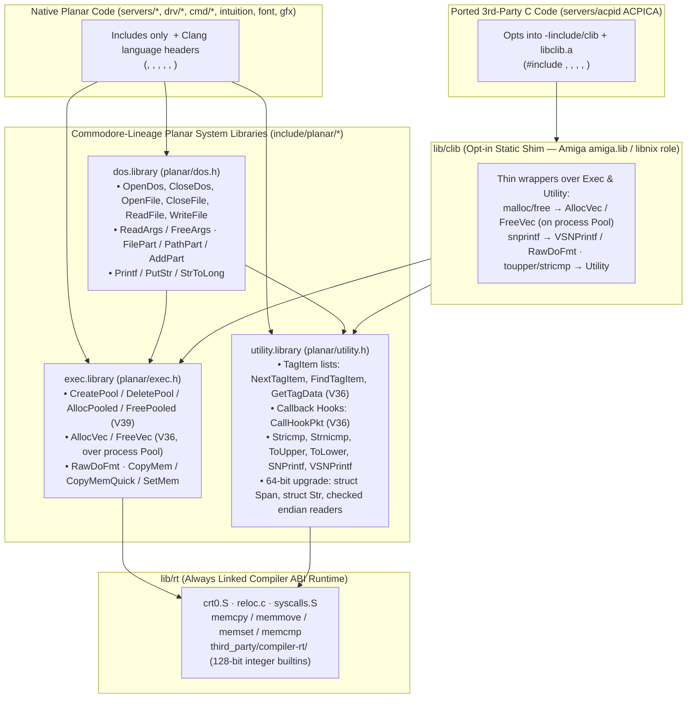

# 17. C23 runtime, `libc`, and scaling up the Commodore V36–V40 libraries (`exec.library`, `utility.library`, `dos.library`, `lib/clib`)

**Status: proposed (2026-10-21).** Builds on the single address space ([§3](03-memory.md)), zero-copy IPC rings ([§4](04-ipc.md)), C23 language and SIMD policy ([§7](07-language-toolchain.md)), and fault containment ([§12](12-let-it-crash.md)).

Planar is written in freestanding C23 (`-std=c23 -ffreestanding -fno-builtin -nostdlib`) with Clang/LLD 22 ([§7.3](07-language-toolchain.md#73-c23-baseline)). That raises two distinct questions:

1. **What must Planar provide to satisfy Clang/LLVM 22 codegen and standard C23?** Every binary needs the compiler ABI runtime (`memcpy`, `memmove`, `memset`, `memcmp`, self-relocation, and 128-bit integer builtins), and third-party standard C code (such as ACPICA in `servers/acpid/`) expects a small C library surface (`<string.h>`, `<ctype.h>`, `<stdlib.h>`, `<stdio.h>` `snprintf`).
2. **What replaces standard `libc` for native Planar software so we do not inherit 1970s PDP-11 assumptions?** Standard Unix/ANSI `libc` (`malloc`/`free` over `sbrk`, NUL-terminated `char *` strings, buffered `FILE *` streams, `argc`/`argv` + `getopt`, and global `errno`) was shaped around a 16-bit PDP-11 running Seventh Edition Unix. Those assumptions fight Planar's identity single address space (`VA = PA`), zero-copy shared `Area`s, wide SIMD (`RVV 1.0`, `NEON`, `SVE2`), and "let it crash" recovery.

Because Planar follows the Amiga architecture, we do not need to invent a foreign paradigm. **Commodore designed AmigaOS (Kickstart V36–V40) so that native C programs never needed a Unix `libc`.** What Unix stuffed into `libc`, Commodore split across three stateless, reentrant system libraries—**`exec.library`**, **`dos.library`**, and **`utility.library`**—while keeping an optional static glue library (`amiga.lib` / `libnix`) on the side strictly for ported ANSI C code.

This document specifies how Planar scales that exact Commodore V36–V40 split up to 64-bit C23.

---

## 17.1 Core decisions

1. **Only Commodore APIs (Kickstart V36–V40 / RKM 3rd Edition) are canonical.**
   Public library functions and semantics follow Commodore's RKM 3rd Edition (`CreatePool`, `DeletePool`, `AllocPooled`, `FreePooled`, `AllocVec`, `FreeVec`, `RawDoFmt`, `NextTagItem`, `CallHookPkt`, `ReadArgs`, `FilePart`) in **RKM `CamelCase`** (**VQ18**, decided), with `<stdint.h>` fixed-width types replacing 32-bit `ULONG`/`APTR`. Post-Commodore clones do not exist as far as Planar is concerned.
2. **Struct interface tables (`IExec->`, `IUtility->`, `IDos->`) are adopted independently as Planar's C namespacing and jump-table mechanism ([§7.2](07-language-toolchain.md#72-decision)).**
   Using a struct of function pointers gives C23 namespacing without name mangling, per-interface versioning, and runtime CPU/SIMD selection (**VQ22**), while direct `CamelCase` calls continue to compile cleanly.
3. **Native Planar code uses `exec.library`, `dos.library`, and `utility.library`—not `libc`.**
   Servers, drivers, commands, and applications include only `<planar/*.h>` and Clang's freestanding language headers (`<stdint.h>`, `<stddef.h>`, `<stdbool.h>`, `<stdarg.h>`, `<stdatomic.h>`, `<stdckdint.h>`).
4. **Standard C library headers are strictly opt-in (`include/clib/` + `lib/clib`).**
   Third-party C code (such as ACPICA in `servers/acpid/`) opts into `-Iinclude/clib` and links `libclib.a`, which implements `<stdlib.h>`, `<string.h>`, `<ctype.h>`, `<stdio.h>` (`snprintf`), and `<stdbit.h>` as thin wrappers over `exec.library` and `utility.library`.
5. **LLVM `compiler-rt` 128-bit integer builtins are vendored into `third_party/compiler-rt/`.**
   Linked into `lib/rt` alongside `crt0.S`, `reloc.c`, `syscalls.S`, and `string.c` so Clang 22 codegen for `__int128` and `_BitInt(128)` arithmetic always resolves cleanly.

---

## 17.2 Why PDP-11 `libc` assumptions fail on Planar—and how Commodore solved them

David Chisnall's critique (*"C Is Not a Low-Level Language: Your Computer Is Not a Fast PDP-11"*) applies directly to `<stdlib.h>`, `<string.h>`, and `<stdio.h>`. Five 1970s PDP-11 assumptions are baked into standard `libc`; Commodore's V36–V40 APIs already solved four of them, and a 64-bit register-pair slice extension (`struct Span` / `struct Str`) in `utility.library` solves the fifth:

| PDP-11 / Unix `libc` assumption | Why it fails on Planar | Commodore V36–V40 + 64-bit Planar replacement |
|---|---|---|
| **1. Ambient global `malloc`/`free` (`sbrk`)** | Planar has no `brk` ([§3.1](03-memory.md#31-model)). Memory comes in non-adjacent physical `Area`s with distinct hardware flags (`AREAF_DMA32`, `AREAF_NC`) or shared `ConnArena`s. Global heaps contend on SMP locks and obscure lifetime ownership. | **`exec.library` V39 Pools (`CreatePool`, `DeletePool`, `AllocPooled`, `FreePooled`) & V36 `AllocVec`/`FreeVec`.** Subsystems create a pool with explicit `AREAF_*` flags and tear down the entire pool in one `DeletePool` call. |
| **2. Stateful `FILE *` streams & integer `fd` tables** | Adds hidden 4 KiB user-space buffer copies, internal locks (`flockfile`), and ambient global fd numbers over Planar's stateless offset-based `dos` protocol and zero-copy `ShareArea`s. | **`exec.library` `RawDoFmt` + `dos.library` `Printf` / `FPrintf` / `PutStr`.** Formatting is a pure, stateless callback engine (`RawDoFmt`); console and file output speak directly to the caller's DOS connection. |
| **3. `argc`/`argv` pointer vectors + stateful `getopt()`** | Forces the loader to tokenize strings into pointer arrays and relies on global `optarg`/`optind`. Planar's loader (`lib/dos/dos.c`) already passes a single command line in `x0`/`a0`. | **`dos.library` V36 `ReadArgs` / `FreeArgs`.** Declarative template parsing (`"FROM/A,TO/A,ALL/S,COUNT/K/N"`) over the command-line string with built-in `?` help. |
| **4. Ambient mutable state (`errno`, `strtok`, `locale`)** | Violates stateless shared `RX` libraries ([§2.1](02-architecture.md#21-layers)). | **Explicit `ERR_*` return codes + `utility.library` (`TagItem`, `Hook`, `Stricmp`).** Zero hidden library state. |
| **5. NUL-terminated `char *` & unchecked raw pointers** | Taking a substring of a read-only shared `Area` (`AREAR_READ` FDT, ACPI, or OpenType font table in [§14](14-font-engine.md)) is impossible with `'\0'` mutation without copying. Sentinel loops block SIMD and risk M14-style offset wraps ([§10.7](10-code-review.md#107-medium-boot-build-and-tests)). | **`utility.library` 64-bit `struct Span` & `struct Str`.** 16-byte `{ ptr, len }` value structs passed in two registers (`x0/x1`, `a0/a1`) with `<stdckdint.h>` bounds-checked endian readers. |

---

## 17.3 Layer architecture



---

## 17.4 Component specifications

### 17.4.1 `lib/rt` and `third_party/compiler-rt/` (The Clang 22 ABI floor)

Every user binary links `USER_RT` (`mk/user.mk`). It contains strictly what Clang 22 emits implicitly:

1. **Startup & self-relocation**: `arch/<isa>/user/crt0.S` and `lib/rt/reloc.c` (`_start`, `_relocate`).
2. **Compiler memory intrinsics**: `memcpy`, `memmove`, `memset`, `memcmp` in `lib/rt/string.c`, upgraded from byte loops to 64-bit word / SIMD (`RVV 1.0` on RV64, `NEON` on AArch64) loops that handle unaligned heads and tails safely.
3. **Vendored 128-bit integer builtins (`third_party/compiler-rt/`)**:
   - Vendored from LLVM 22's `compiler-rt/lib/builtins/` (`Apache-2.0 WITH LLVM-exception`):
     - `udivmodti4.c`, `divti3.c`, `udivti3.c`, `modti3.c`, `umodti3.c`, `multi3.c` (with minimal `int_types.h`).
   - Satisfies software `__int128` and `_BitInt(128)` division, modulo, and multiplication on both `rv64` and `aarch64`.
4. **C23 `thread_local` support (when needed)**:
   - `.tdata` / `.tbss` sections in `arch/<isa>/user/user.ld` initialized per task in `crt0.S` and `CreateTask`, pointed to by `tp` (RV64) and `TPIDR_EL0` (AArch64, context-switched since V2.5 M3).

---

### 17.4.2 `exec.library` (`include/planar/exec.h`, `lib/exec/`)

Follows Commodore Kickstart V36–V39 `exec.library` signatures, adapted for 64-bit `Area`s:

#### 1. V39 Memory Pools (`CreatePool`, `DeletePool`, `AllocPooled`, `FreePooled`)

```c
struct Pool;

/*
 * V39 Pool allocator over Areas.
 * - areaFlags:  AREAF_* flags passed to AllocArea for each puddle (0, AREAF_DMA32, AREAF_NC).
 * - puddleSize: byte size of each shared puddle Area (page-rounded, e.g. 64 KiB or 1 MiB).
 * - threshSize: allocations > threshSize get their own dedicated Area.
 *
 * CreatePoolMem initializes a fixed-capacity pool inside an existing buffer (such as a
 * connection's ConnArena heap) that never calls AllocArea.
 */
struct Pool *CreatePool(uint32_t areaFlags, uint64_t puddleSize, uint64_t threshSize);
struct Pool *CreatePoolMem(void *buf, uint64_t size);
void         DeletePool(struct Pool *poolHeader);

/* Canonical Commodore V39 pooled allocation */
void *AllocPooled(struct Pool *poolHeader, uint64_t memSize);
void  FreePooled(struct Pool *poolHeader, void *memory, uint64_t memSize);
```

- **How `AllocPooled` / `FreePooled` work**:
  - Small allocations (`<= threshSize`) round `memSize` up to a 16-byte multiple (or power-of-two bucket) and pop from the bucket's free list or bump-allocate from the current puddle `Area`.
  - Large allocations (`> threshSize`) allocate a dedicated `Area` linked onto the pool's area list so `DeletePool` frees both puddles and large `Area`s alike.
  - Because `FreePooled` takes `memSize` (canonical V39), zero header bytes are wasted on small pooled allocations, and callers that free whole lifetimes via `DeletePool(poolHeader)` never call `FreePooled` at all.

#### 2. V36 Size-Tracked Allocations (`AllocVec`, `FreeVec`)

In Kickstart 2.0 (V36), Commodore introduced `AllocVec` / `FreeVec` for callers that want size-tracked allocations without passing `byteSize` back on free:

```c
/*
 * V36 size-tracked allocation. Stores the allocation's byte size in a 16-byte
 * prefix header and allocates from a per-process default Pool (or a dedicated
 * Area when non-default AREAF_* flags are requested).
 */
void *AllocVec(uint64_t byteSize, uint32_t requirements);
void  FreeVec(void *memoryBlock);
```

- `AllocVec` / `FreeVec` replaces `servers/acpid/heap.c` (`AcpiOsAllocate` $\rightarrow$ `AllocVec(size, 0)`, `AcpiOsFree` $\rightarrow$ `FreeVec(ptr)`) and backs `lib/clib`'s `malloc` and `free`.

#### 3. `RawDoFmt` and `CopyMem` / `CopyMemQuick` / `SetMem`

```c
typedef void (*PutChProc)(char ch, void *putChData);

/*
 * Canonical Exec formatter. Calls putChProc(ch, putChData) for every formatted byte;
 * emits a trailing '\0' at the end of the format string.
 * Supports: %s (NUL-terminated), %S (struct Str slice), %c, %d, %ld, %lld,
 * %u, %lu, %llu, %x, %lx, %llx, %p, field width, '-' left-align, '0' pad.
 */
void RawDoFmt(const char *formatString, va_list dataStream, PutChProc putChProc, void *putChData);

void CopyMem(const void *source, void *dest, uint64_t size);
void CopyMemQuick(const void *source, void *dest, uint64_t size);
void SetMem(void *dest, uint8_t value, uint64_t size);
```

---

### 17.4.3 `utility.library` (`include/planar/utility.h`, `lib/utility/`)

Matches Commodore Kickstart V36–V39 `utility.library` (`TagItem`, `Hook`, `Stricmp`, `ToUpper`, `SNPrintf`), plus the 64-bit register-pair slice (`Span` / `Str`) and checked endian primitives that fix C's PDP-11 pointer model:

```c
#ifndef PLANAR_UTILITY_H
#define PLANAR_UTILITY_H

#include <stdarg.h>
#include <stdckdint.h>
#include <stddef.h>
#include <stdint.h>

/* --- 1. V36 TagItem lists (widened to 64-bit) --- */

typedef uint64_t Tag;

struct TagItem {
    Tag      ti_Tag;
    uint64_t ti_Data;
};

constexpr Tag TAG_DONE   = 0;   /* terminates array of TagItems */
constexpr Tag TAG_END    = 0;   /* synonym for TAG_DONE */
constexpr Tag TAG_IGNORE = 1;   /* ignore this item, not end of array */
constexpr Tag TAG_MORE   = 2;   /* ti_Data is pointer to another TagItem array */
constexpr Tag TAG_SKIP   = 3;   /* skip this and the next ti_Data items */
constexpr Tag TAG_USER   = 1ULL << 31;

struct TagItem *NextTagItem(const struct TagItem **tagListPtr);
struct TagItem *FindTagItem(Tag tagValue, const struct TagItem *tagList);
uint64_t        GetTagData(Tag tagValue, uint64_t defaultVal, const struct TagItem *tagList);
bool            TagInArray(Tag tagValue, const Tag *tagArray);

/* --- 2. V36 Callback Hooks --- */

struct Hook {
    uint64_t (*h_Entry)(struct Hook *hook, void *object, void *message);
    uint64_t (*h_SubEntry)(struct Hook *hook, void *object, void *message);
    void      *h_Data;
};

uint64_t CallHookPkt(struct Hook *hook, void *object, void *paramPacket);

/* --- 3. V36/V39 String, Character & Formatting Utilities --- */

int     ToUpper(int c);
int     ToLower(int c);
int     Stricmp(const char *s1, const char *s2);
int     Strnicmp(const char *s1, const char *s2, uint64_t n);
int64_t VSNPrintf(char *buffer, uint64_t bufferSize, const char *fmt, va_list args);
int64_t SNPrintf(char *buffer, uint64_t bufferSize, const char *fmt, ...);

/* --- 4. 64-Bit Slice & Checked Binary Reader Primitives --- */

/*
 * 16-byte register-pair views into memory (often a read-only shared Area).
 * Passed and returned by value in (x0, x1) on AArch64 and (a0, a1) on RV64.
 */
struct Span {
    const uint8_t *sp_Data;
    uint64_t       sp_Len;
};

struct Str {
    const char *st_Data;
    uint64_t    st_Len;
};

#define STR(lit) ((struct Str){ .st_Data = (lit), .st_Len = sizeof(lit) - 1 })

struct Str StrFromC(const char *s);
struct Str StrSlice(struct Str s, uint64_t start, uint64_t end);
struct Str StrTrim(struct Str s);
bool       StrSplit(struct Str s, char sep, struct Str *head, struct Str *tail);
bool       StrSame(struct Str a, struct Str b);
bool       StrSameNoCase(struct Str a, struct Str b);
bool       StrHasPrefix(struct Str s, struct Str prefix);
bool       StrToU64(struct Str s, unsigned base, uint64_t *out);

/* Overflow-checked binary slicing and endian loads (built on <stdckdint.h>) */
bool SpanSlice(struct Span s, uint64_t offset, uint64_t len, struct Span *out);
bool SpanReadU16LE(struct Span s, uint64_t offset, uint16_t *out);
bool SpanReadU32LE(struct Span s, uint64_t offset, uint32_t *out);
bool SpanReadU64LE(struct Span s, uint64_t offset, uint64_t *out);
bool SpanReadU16BE(struct Span s, uint64_t offset, uint16_t *out);
bool SpanReadU32BE(struct Span s, uint64_t offset, uint32_t *out);
bool SpanReadU64BE(struct Span s, uint64_t offset, uint64_t *out);

#endif /* PLANAR_UTILITY_H */
```

---

### 17.4.4 `dos.library` (`include/planar/dos.h`, `lib/dos/`)

Aligns `include/planar/dos.h` with Commodore RKM `CamelCase` conventions and adds V36 `ReadArgs`, path manipulation, and `RawDoFmt`-backed console formatting:

| Current `planar/dos.h` name | Canonical RKM `CamelCase` name | Role |
|---|---|---|
| `dos_open` / `dos_close` | `OpenDos` / `CloseDos` | Connect / disconnect `struct Dos` to the `dos` server |
| `dos_file` / `dos_close_file` | `OpenFile` / `CloseFile` | Open / close a file on a volume |
| `dos_read` / `dos_write` | `ReadFile` / `WriteFile` | Offset-based file read/write |
| `dos_stat` / `dos_next` | `ExaminePath` / `ExamineNext` | Stat a path or iterate a directory |
| `dos_remove` / `dos_mkdir` | `DeletePath` / `CreateDir` | Delete or create directory |
| `dos_volume` | `NextVolume` | Enumerate mounted volumes |
| `dos_run` / `dos_args` | `RunCommand` / `SplitArgs` | Load ELF into an `Area` and spawn process |
| `dos_path` | `AddPart` (plus `FilePart`, `PathPart`) | RKM V36 path manipulation |
| *(new)* | `ReadArgs` / `FreeArgs` | RKM V36 template-driven CLI argument parser (`"FROM/A,TO/A,QUIET/S,LINES/K/N"`) |
| `con_open` / `con_close` | `OpenCon` / `CloseCon` | Connect to `con.0` (with `KLog` fallback) |
| `con_write` / `con_puts` / `con_dec` | `WriteCon` / `PutStr` / `Printf` / `VPrintf` | Console output formatted via `RawDoFmt` |

---

### 17.4.5 `include/clib/` & `lib/clib` (Opt-in standard C23 library)

Targets that compile third-party standard C code (such as `servers/acpid/` in `mk/user.mk`) add `USER_CFLAGS += -Iinclude/clib` and link `$(BUILD)/user/libclib.a`.

```
include/clib/
  assert.h      ctype.h       errno.h       inttypes.h
  stdbit.h      stdio.h       stdlib.h      string.h
```

- **`<stdlib.h>`**:
  - `malloc(size)` $\rightarrow$ `AllocVec(size, 0)`
  - `calloc(n, size)` $\rightarrow$ checked multiply via `ckd_mul`, then `AllocVec(total, AREAF_CLEAR)`
  - `free(ptr)` $\rightarrow$ `FreeVec(ptr)`
  - `realloc(ptr, newSize)` $\rightarrow$ `AllocVec` + `CopyMem` + `FreeVec`
  - `abort()` / `exit(status)` / `_Exit(status)` $\rightarrow$ `ExitProcess(status)`
  - `strtol`, `strtoul`, `strtoll`, `strtoull`, `qsort`, `bsearch`, `abs`, `labs`, `llabs`, `memalignment`
- **`<string.h>`**:
  - `memcpy`, `memmove`, `memset`, `memexplicit`, `memcmp` (from `lib/rt`), plus `memchr`, `strlen`, `strnlen`, `strcmp`, `strncmp`, `strcpy`, `strncpy`, `strcat`, `strncat`, `strchr`, `strrchr`, `strstr`.
- **`<ctype.h>`**:
  - C-locale ASCII inline predicates and `toupper`/`tolower`.
- **`<stdio.h>`**:
  - `snprintf` and `vsnprintf` (calling `utility.library`'s `VSNPrintf`).
- **`<stdbit.h>`**:
  - Wraps Clang 22's `__builtin_stdc_*` intrinsics for C23 bit and byte operations.

---

## 17.5 Implementation plan

1. **Step 1 — `third_party/compiler-rt` & `lib/rt` SIMD/word memory ops**:
   - Vendor LLVM 22's 128-bit integer builtins (`udivmodti4.c`, `divti3.c`, `udivti3.c`, `modti3.c`, `umodti3.c`, `multi3.c`).
   - Upgrade `lib/rt/string.c` from byte-by-byte loops to word/SIMD loops and expose `CopyMem`, `CopyMemQuick`, `SetMem` in `include/planar/exec.h`.
2. **Step 2 — `exec.library` V39 Pools, V36 `AllocVec`/`FreeVec`, and `RawDoFmt`**:
   - Add `lib/exec/pool.c` (`CreatePool`, `CreatePoolMem`, `DeletePool`, `AllocPooled`, `FreePooled`, `AllocVec`, `FreeVec`) and `lib/exec/fmt.c` (`RawDoFmt`).
   - Add conformance tests (`conformance/pool.c`) covering puddles, threshold `Area`s, fixed-buffer pools, and `DeletePool` reclamation.
3. **Step 3 — `utility.library` (`include/planar/utility.h`, `lib/utility/`)**:
   - Implement `TagItem` functions, `CallHookPkt`, `Stricmp`/`Strnicmp`/`ToUpper`/`ToLower`, `SNPrintf`/`VSNPrintf`, `struct Span` / `struct Str`, and bounds-checked endian readers.
   - Simplify `conformance/log.h` to use `SNPrintf`.
4. **Step 4 — Opt-in `include/clib/` & `lib/clib/` (`acpid` migration)**:
   - Build `libclib.a` on top of `AllocVec`/`FreeVec`, `VSNPrintf`, and `utility.library`.
   - Migrate `servers/acpid/` to `-Iinclude/clib` + `libclib.a` and delete `servers/acpid/clib.c` and `servers/acpid/heap.c`.
5. **Step 5 — `dos.library` RKM `CamelCase` & `ReadArgs`**:
   - Add `ReadArgs`/`FreeArgs`, `FilePart`/`PathPart`/`AddPart`, and `Printf`/`PutStr` to `lib/dos/`, and update `cmd/*.c` to use `ReadArgs`.
6. **Step 6 — Manuals & Autodocs**:
   - Add `manuals/libraries/05-utility.md`, update `manuals/libraries/03-areas.md` (covering Pools and `AllocVec`), and add autodocs in `manuals/autodocs/exec.md`, `utility.md`, and `dos.md`.
