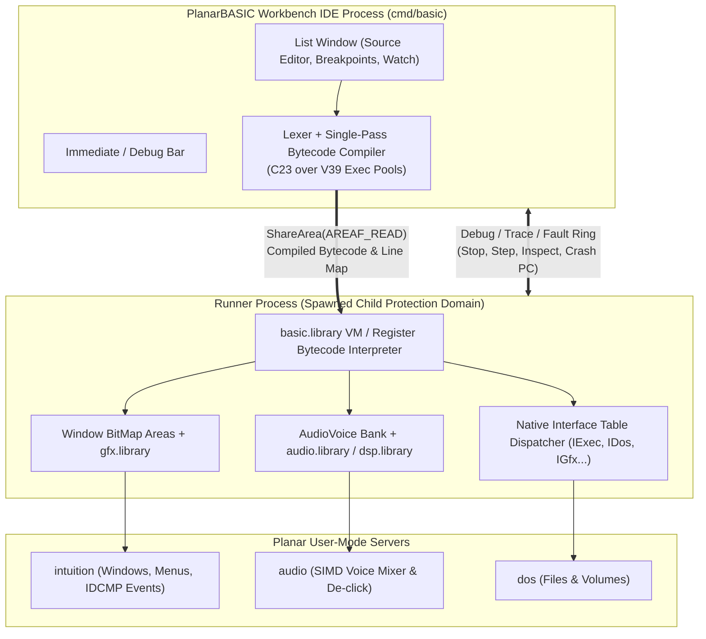

# 18. PlanarBASIC: Interactive Workbench Scripting and System FFI (`basic`, `basic.library`)

**Status: proposed (2026-10-26).** Builds on the single address space ([§3](03-memory.md)), zero-copy IPC rings ([§4](04-ipc.md)), C23 interface tables ([§7.2](07-language-toolchain.md#72-decision), [§17.1](17-c-runtime-and-libraries.md#171-core-decisions)), hardware fault containment ([§12](12-let-it-crash.md)), the Workbench windowing and widget stack ([§13](13-workbench.md)), the audio and DSP subsystem ([§15](15-audio-dsp.md)), and the modern DPU/GPU RTG architecture ([§16](16-rtg-display-gpu.md)).

When Commodore shipped the Amiga 1000 in 1985, it bundled **AmigaBASIC** (written by Microsoft for Commodore, documented in the 314-page *Amiga BASIC Manual*). Unlike 8-bit ROM BASICs that forced programmers into line-numbered spaghetti and `POKE` loops, AmigaBASIC made four forward-looking design choices:

1. **A live, mouse-driven multi-window environment** (`Output` window and `List` editor window) integrated directly into the Intuition desktop.
2. **Structured procedural syntax without line numbers** (alphanumeric labels, `IF ... THEN ... ELSE`, `WHILE ... WEND`, and local/static `SUB ... END SUB` procedures).
3. **High-level declarative access to custom multimedia hardware**: windows (`WINDOW`), pull-down menus (`MENU`), mouse and event traps (`ON MENU`, `ON MOUSE`, `ON TIMER`, `ON COLLISION`), polygon fills (`AREA` / `AREAFILL`), animated hardware sprites and Blitter Objects (`OBJECT.*`), multi-voice wavetable audio (`WAVE`, `SOUND`), and speech synthesis (`TRANSLATE$`, `SAY`).
4. **Direct dynamic FFI to OS shared libraries (`LIBRARY` and `DECLARE FUNCTION`)**: any program could open `graphics.library`, `intuition.library`, or `dos.library` via `.bmap` offset tables and call native OS entry points without writing a line of C or assembly.

AmigaBASIC failed in practice only because of two 1985 implementation flaws: it used 16/24-bit pointer assumptions that broke on 32-bit CPUs and Fast RAM, and any buggy `POKE` or `CALL` inside a user script immediately corrupted shared memory and triggered a system-wide Guru Meditation.

**PlanarBASIC** takes the exact language scope and user experience of the 1985 *Amiga BASIC Manual* and scales it up to Planar's 64-bit Single Address Space, C23 `IExec->` interface tables, zero-copy `Area`s, and hardware protection domains.

---

## 18.1 Why AmigaBASIC Belongs in Planar's Scope

Planar's goal is a machine one person can hold in their head ([§7.1](07-language-toolchain.md#71-why-c23-and-candidates)). While C23 is the systems language for the kernel, drivers, servers, and shared libraries, an operating system in the Amiga lineage also benefits from a **zero-friction, immediate-mode scripting and prototyping language** that ships in the base image:

1. **Instant access to every Planar subsystem in 5 lines of code.** Opening a hardware-composited `intuition` window, drawing anti-aliased paths via `gfx.library`, triggering a 4-voice polyBLEP or wavetable chord on `audio.library`, and handling pull-down menu events takes half a page of readable PlanarBASIC—with no host cross-compiler required.
2. **Solving AmigaBASIC's two historical flaws in hardware and ABI:**
   - **64-bit clean by construction.** Suffixes and types scale cleanly to 64-bit (`%` = `int32_t`, `&` = `int64_t` / universal pointer, `!` = `float`, `#` = `double`, `$` = `struct Str` slice over a pooled buffer).
   - **Crash-proof execution ("Let It Crash", [§12](12-let-it-crash.md)).** The PlanarBASIC IDE (`Output` + `List` windows) runs in one protection domain, and the user's running program executes in a **child runner protection domain**. If a user script executes a wild `POKE` or passes a bogus pointer to a native `LIBRARY` function, the hardware MMU traps into `process_fault`, kills only the runner domain, automatically closes its windows (`kill-window`, [§13.1](13-workbench.md#crash-containment-let-it-crash-for-the-gui)), de-clicks its active audio voices ([§15.4](15-audio-dsp.md#154-fault-tolerance-click-free-let-it-crash)), and highlights the faulting statement in the `List` editor window without dropping a frame on the Workbench.
3. **Zero-glue OS FFI via C23 Interface Tables ([§7.2](07-language-toolchain.md#72-decision)).**
   In 1985, AmigaBASIC needed external `.bmap` files to specify which 68000 registers (`D0`–`D7`, `A0`–`A4`) each library LVO expected. In Planar, every public shared library (`exec.library`, `dos.library`, `utility.library`, `gfx.library`, `ui.library`, `audio.library`, `dsp.library`) uses the **standard C ABI** (`rv64` LP64D / `aarch64` AAPCS64) through an interface table in the shared RX library region. Calling `LIBRARY "gfx.library"` requires zero per-function assembly stubs.

---

## 18.2 Architecture and Two-Domain Execution Model

Following P3 (*the kernel provides mechanism and servers provide policy*) and [§12](12-let-it-crash.md), PlanarBASIC splits the interactive IDE from the executing target program across two protection domains connected by a shared `ConnArena` and a read-only bytecode `Area`:



| Component | Location | Role |
|---|---|---|
| `basic.library` | `lib/basic/` (Shared RX library) | Stateless tokenizer, single-pass compiler to register bytecode, `.bmap` / interface symbol resolver, and fast C23 computed-goto interpreter. |
| `cmd/basic` | `cmd/basic/` (Workbench & CLI app) | In CLI mode (`basic prog.bas`), runs `basic.library` directly in the caller's process. In Workbench mode, manages the `List` and `Output` windows and spawns an isolated runner process on `RUN`. |
| **Bytecode `Area`** | Shared `Area` (`AREAF_READ`) | Holds the compiled 32-bit instruction stream, constant pool, string table, and PC-to-source-line map so the IDE can highlight the active or faulting line in `O(1)` time. |
| **Runner Process** | Child protection domain | Owns the `Output` window (or custom `WINDOW`s), `AudioVoice` handles, open DOS file handles, and its own V39 `Pool` (`CreatePool`) for runtime strings and arrays. |

### What Happens When a Script Crashes

In Commodore's 1985 AmigaBASIC, `POKE 4, 0` overwrote `ExecBase` in low Chip RAM and crashed the machine. In PlanarBASIC:

1. The runner process executes `POKE` or a native `CALL` in its own hardware protection domain.
2. Any write outside the runner's writable `Area`s traps into `process_fault` in `kernel/process.c`.
3. The kernel reclaims the runner's handles, notifies `intuition` (`CONNF_CLIENT_GONE` $\rightarrow$ dead windows vanish on the next vblank) and `audio` (5 ms raised-cosine fade-out ramp), and delivers the fault notice (`fault_pc`, `fault_addr`, `fault_cause`) to the supervising `cmd/basic` IDE process.
4. The IDE maps `fault_pc` (or the current VM `pc` in the shared debug page) back to the exact line and column in the `List` window and displays a non-modal error banner:
   `Protection Fault (Write to unmapped address 0x00000004) at line 42: POKE 4, 0`.

---

## 18.3 Language Specification: Commodore 1985 AmigaBASIC Scaled to 64-Bit

PlanarBASIC preserves the complete syntax and statement vocabulary of the 1985 *Amiga BASIC Manual* (Chapters 3–8), updated for 64-bit types and modern displays.

### 18.3.1 Data Types, Suffixes, and Memory Representation

| Type / Suffix | Classic AmigaBASIC (1985) | PlanarBASIC (64-bit) | Representation in VM |
|---|---|---|---|
| **Short Integer (`%`)** | 16-bit signed (`-32768..32767`) | **32-bit signed (`int32_t`)** | Unboxed 64-bit register slot (`DEFINT`). |
| **Long / Pointer (`&`)** | 32-bit signed (`int32_t`) | **64-bit signed (`int64_t` / `uaddr_t`)** | Unboxed 64-bit register slot (`DEFLNG`). Holds universal pointers (`VARPTR`, `SADD`, `Area` base addresses, handles) without truncation! |
| **Single Float (`!`)** | 32-bit MBF / IEEE float | **32-bit IEEE 754 `float`** | Default untyped numeric (`DEFSNG`); matches `dsp.library` and `gfx.library` coordinates. |
| **Double Float (`#`)** | 64-bit MBF / IEEE float | **64-bit IEEE 754 `double`** | Hardware `D` register on `rv64` and `aarch64` (`DEFDBL`). |
| **String (`$`)** | 16-bit length + 24-bit pointer | **`struct Str` (`{ const char *ptr; uint64_t len; }`)** | 16-byte value descriptor ([§17.4.3](17-c-runtime-and-libraries.md)). Literal and substring slices (`MID$`, `LEFT$`, `RIGHT$`) point straight into the read-only source/bytecode `Area` with **zero allocation or copying**! Mutated strings allocate from the runner's string `Pool`. |
| **Arrays (`DIM`)** | Max 32 KiB per dimension | **64-bit contiguous pooled `Area`s** | `DIM A!(1024)` allocates a 64-byte-aligned contiguous buffer in the runner's `Pool`, directly passable to SIMD `dsp.library` or `gfx.library` routines via `VARPTR(A!(0))`. |

### 18.3.2 Program Flow, Structured Procedures, and Event Trapping

- **No required line numbers**: Programs use alphanumeric labels (`MainLoop:`, `OnQuit:`) alongside optional legacy line numbers for compatibility with 1985 type-in listings.
- **Structured loops & conditionals**:
  - `IF expr THEN ... ELSEIF expr THEN ... ELSE ... END IF` (both single-line and multi-line block forms).
  - `WHILE expr ... WEND`, `DO [WHILE|UNTIL expr] ... LOOP [WHILE|UNTIL expr]`, `EXIT DO`.
  - `FOR var = start TO end [STEP delta] ... NEXT [var]`, `EXIT FOR`.
  - `SELECT CASE expr ... CASE ... CASE ELSE ... END SELECT`.
- **Subprograms (`SUB`) and Functions (`DEF FN` / `FUNCTION`)**:
  - `SUB Name (param1, param2, array()) [STATIC] ... EXIT SUB ... END SUB`
  - Variables inside a `SUB` are local by default; `SHARED var1, var2()` imports module-level globals without global side effects.
  - `COMMON` and `CHAIN "prog2.bas"` pass shared variables across chained programs in the runner's `Pool`.
- **Event Trapping (Cooperative Poll at Loop Back-Edges and `SLEEP`)**:
  - Exactly as specified in Chapter 6 of the *Amiga BASIC Manual*, background events never preempt mid-expression or corrupt variable state. Instead, the VM checks a single combined 32-bit `pending_events` atomic word at loop back-edges (`WEND`, `LOOP`, `NEXT`), procedure calls, and during `SLEEP`:
    - `ON MENU GOSUB Label` (`MENU ON` / `MENU OFF` / `MENU STOP`)
    - `ON MOUSE GOSUB Label` (`MOUSE ON` / `MOUSE OFF` / `MOUSE STOP`)
    - `ON TIMER(seconds!) GOSUB Label` (`TIMER ON` / `TIMER OFF` / `TIMER STOP`)
    - `ON COLLISION GOSUB Label` (`COLLISION ON` / `COLLISION OFF` / `COLLISION STOP`)
    - `ON BREAK GOSUB Label` (`BREAK ON` / `BREAK OFF` / `BREAK STOP`)
    - `ON ERROR GOTO Label` (`RESUME`, `RESUME NEXT`, `ERR`, `ERL`, `ERROR code`)

---

## 18.4 Mapping Multimedia Primitives to Planar Subsystems

Every Amiga-specific statement in the 1985 specification maps cleanly onto Planar's existing libraries and servers:

### 18.4.1 Screens, Windows, Menus, and Mouse (`intuition` + `ui.library`, [§13](13-workbench.md))

| AmigaBASIC Statement / Function | Planar Realisation (`intuition` & `ui.library`) |
|---|---|
| `SCREEN id, width, height, depth, mode` / `SCREEN CLOSE id` | Opens or closes a custom `intuition` `Screen` backed by a hardware DPU plane ([§16.3 Pillar 3](16-rtg-display-gpu.md#pillar-3-view-viewport-and-mrgcop-as-hardware-dpu-plane-composition)). Supports both classic indexed palettes (`depth <= 8`) and native `ARGB8888` (`depth = 32`). |
| `WINDOW id, [title$], [(x1,y1)-(x2,y2)], [type], [screen_id]` | Creates a zero-copy `intuition` window ([§13.1](13-workbench.md#zero-copy-window-surfaces)) backed by `AllocBitMap(BMF_DISPLAYABLE)`. `type` flags (`1`=sizing, `2`=drag, `4`=depth, `8`=close, `16`=smart refresh) map directly to `intuition` window flags. |
| `WINDOW OUTPUT id` / `WINDOW CLOSE id` | Directs subsequent `PRINT`, `LINE`, `CIRCLE`, `PSET`, and `AREAFILL` calls to window `id`'s backing `BitMap` `Area`. |
| `WINDOW(n)` | Queries window state: `WINDOW(0)` = active window ID, `WINDOW(1)` = current output window ID, `WINDOW(2)`/`(3)` = inner width/height, `WINDOW(4)`/`(5)` = graphics pen $(x, y)$, `WINDOW(6)` = max color register, `WINDOW(7)` = raw `Window *` / handle for native `LIBRARY` calls, `WINDOW(8)` = raw `RastPort` / `GfxContext *` pointer. |
| `MENU class, item, state, title$` / `MENU RESET` | Populates the window's pull-down menu strip in the global Workbench screen bar ([§13.2](13-workbench.md#132-visual-design-system)). `MENU(0)` returns the selected menu class; `MENU(1)` returns the selected item ID when `ON MENU` triggers. |
| `MOUSE(n)` | Reads the window's `InputEvent` ring: `MOUSE(0)` = button click status (`0` none, `1` single-click, `2` double-click, `-1`/`-2` button held down), `MOUSE(1)`/`(2)` = current $(x, y)$, `MOUSE(3)`/`(4)` = button-down start $(x, y)$, `MOUSE(5)`/`(6)` = button-up release $(x, y)$. |
| `SLEEP` | Blocks the runner task via `Wait` / `WaitAddr` on the `intuition`, `audio`, and timer event rings—consuming **0% CPU** until a mouse click, key press, menu selection, or timer tick arrives! |

### 18.4.2 2D Graphics, Polygons, and Palette (`gfx.library`, [§16](16-rtg-display-gpu.md))

| AmigaBASIC Statement / Function | Planar Realisation (`gfx.library` SIMD & GPU Backend) |
|---|---|
| `PALETTE color_id, red!, green!, blue!` | Updates the window/screen virtual palette table (`red!`, `green!`, `blue!` in `0.0..1.0`, translated to `ARGB8888` sRGB). In 32-bit mode, `RGB(r, g, b)` or hex `0xFFRRGGBB` can also be passed directly as any color argument. |
| `COLOR [fg], [bg]` | Sets active foreground and background colors for text and drawing primitives. |
| `PSET [STEP](x,y), [color]` / `PRESET [STEP](x,y)` / `POINT(x,y)` | Reads or writes pixels in the window's `BitMap` `Area` (`bm_BaseAddr`) and expands the frame's dirty damage rectangle. |
| `LINE [STEP](x1,y1)-[STEP](x2,y2), [color], [B\|BF]` | Calls `gfx.library`'s SIMD line drawer, outline rectangle (`B`), or filled rectangle (`BF`). |
| `CIRCLE [STEP](x,y), radius, [color], [start], [end], [aspect]` | Renders circles, ellipses, and circular arcs via `gfx.library`'s analytical path rasteriser. |
| `AREA [STEP](x,y)` / `AREAFILL [mode]` | Appends vertices to a polygon path (up to any vertex count in the runner's pool, removing 1985's 20-vertex cap) and rasterises the filled polygon (`mode=0` solid/pattern fill, `mode=1` XOR invert) using `gfx.library`'s scanline SIMD filler. |
| `PAINT [STEP](x,y), [fill_color], [border_color]` | Bounded scanline flood-fill over the linear `BitMap` `Area`. |
| `PATTERN line_pat%, area_pat%()` | Sets the 16-bit stipple mask for lines and `8×N` pattern mask for `PAINT` and `AREAFILL`. |
| `GET (x1,y1)-(x2,y2), array` / `PUT (x,y), array, [action]` | Captures a rectangular pixel region into a BASIC array and blits it back using `gfx.library` SIMD blits (`PSET`, `PRESET`, `AND`, `OR`, `XOR` / cookie-cut alpha). |
| `SCROLL (x1,y1)-(x2,y2), dx, dy` | Blits a sub-rectangle by $(dx, dy)$ via `CopyMem` / SIMD blit and clears the uncovered strip to background color. |

### 18.4.3 Animated Objects: Bobs & Sprites (`OBJECT.*`, Chapter 7 of Manual)

One of AmigaBASIC's signature features was its built-in **Object animation engine** (Chapter 7: *Creating Animated Images*), which let programs define sprites and Blitter Objects (Bobs) with position, velocity, acceleration, clipping bounds, and hardware/bounding-box collision detection, animated automatically at the screen refresh rate:

- **Definition & Appearance**:
  - `OBJECT.SHAPE id, definition$` (or `OBJECT.SHAPE id, other_id` to share image data): Supports both original 1985 *Object Editor* bitplane strings and native `ARGB8888` / PNG / icon buffers.
  - `OBJECT.PLANES id, plane_pick, plane_on_off`: Preserved for classic bitplane color remapping.
  - `OBJECT.PRIORITY id, z_priority`: Controls back-to-front draw order among active objects.
- **Kinematics & Autonomous VBlank Motion**:
  - `OBJECT.X id, x` / `OBJECT.Y id, y` — Sets object coordinates (and `OBJECT.X(id)` / `OBJECT.Y(id)` queries current position).
  - `OBJECT.VX id, vx` / `OBJECT.VY id, vy` — Sets velocity in pixels per second (or per frame).
  - `OBJECT.AX id, ax` / `OBJECT.AY id, ay` — Sets acceleration in pixels/sec².
  - `OBJECT.CLIP (x1,y1)-(x2,y2)` — Sets autonomous clipping and border-collision rectangle.
  - `OBJECT.START [id]` / `OBJECT.STOP [id]` / `OBJECT.ON [id]` / `OBJECT.OFF [id]` / `OBJECT.CLOSE [id]`:
    In PlanarBASIC, when any object is active (`OBJECT.ON`), the runner integrates object velocities and accelerations synchronized to the `display` server's 60/120 Hz vblank `safe_seq` ([§13.1](13-workbench.md#zero-copy-window-surfaces)), saves/restores background rectangles in the window `BitMap`, and posts `PresentWindow` automatically!
- **Collision Detection (`COLLISION`)**:
  - `OBJECT.HIT id, me_mask%, hit_mask%` — Assigns 16-bit collision category masks.
  - `COLLISION(id)` — Returns the ID of the object that collided with `id` (or `-1` top border, `-2` bottom, `-3` left, `-4` right when `id = 0`), and fires `ON COLLISION GOSUB` if enabled.

### 18.4.4 Audio, Custom Waveforms, and Speech (`audio.library` & `dsp.library`, [§15](15-audio-dsp.md))

| AmigaBASIC Statement / Function | Planar Realisation (`audio.library` & `dsp.library`) |
|---|---|
| `SOUND freq!, duration!, [volume], [voice]` | Allocates 4 default retained `AudioVoice` channels (`voice = 0..3`, extendable to `0..63` in PlanarBASIC!) via `audio.library` Mode B ([§15.3](15-audio-dsp.md#153-data-path-and-zero-copy-rings)). Queues a sample-accurate note trigger (`VOICE_TRIG`) with micro-ramped gain (`0..255` $\rightarrow$ `0.0..1.0f`) so consecutive `SOUND` statements never click. |
| `WAVE voice, wave_spec` | In 1985, `WAVE voice, SIN` loaded a sine wave and `WAVE voice, array%` loaded a 256-element 8-bit signed waveform (`-128..127`) into Chip RAM. In PlanarBASIC:<ul><li>`WAVE voice, SIN` / `SAW` / `SQUARE` / `TRIANGLE` selects `dsp.library`'s band-limited `DSP_OscBLEP` oscillator ([§15.5](15-audio-dsp.md#155-dsplibrary-simd-and-coprocessor-dsp-engine)).</li><li>`WAVE voice, array%` (or `array!`) copies or shares the user's waveform array into a read-only sample `Area` with cubic Hermite interpolation (`DSP_InterpHermite4`) or classic Paula 7 kHz LED filter mode (`DSP_MODE_PAULA_LED`).</li></ul> |
| `TRANSLATE$(english$)` & `SAY phoneme$, [mode%(9)]` | Maps to an optional small clean-room formant synthesizer (`narrator` mode over `dsp.library`'s cascaded biquad resonators `F1`/`F2`/`F3` + `DSP_OscPhasor` glottal pulse), keeping the exact 9-element `mode%` control array (`pitch`, `inflection`, `rate`, `voice`, `tuning`, `volume`, `channel`, `sync`, `hold`) from Chapter 6 of the manual. |

### 18.4.5 Files, Directories, and Requester Integration (`dos.library` & `ui.library`)

- Standard sequential (`OPEN "O"`, `"I"`, `"A"`) and random-access (`OPEN "R"`, `FIELD`, `LSET`, `RSET`, `GET #`, `PUT #`, `MKI$`/`MKL$`/`MKS$`/`MKD$`, `CVI`/`CVL`/`CVS`/`CVD`) file I/O layered directly over `dos.library` (`OpenFile`, `ReadFile`, `WriteFile`, [§17.4.4](17-c-runtime-and-libraries.md)).
- `FILES [pattern$]` lists directory entries into the current output window; `CHDIR`, `NAME old$ AS new$`, and `KILL file$` call `dos.library`.
- **`FILES$(type, [prompt$])` function**: Opens a standard `ui.library` file requester dialog on the Workbench screen and returns the selected path as a string (or `""` if cancelled), matching AmigaBASIC's built-in file requester function.

---

## 18.5 Native System Library FFI (`LIBRARY` and `DECLARE FUNCTION`)

Appendix H of the 1985 *Amiga BASIC Manual* specified how BASIC programs could call any function in any AmigaOS `.library` using `LIBRARY "name.library"` and `.bmap` files. PlanarBASIC keeps this exact user syntax while making the underlying mechanism 10× simpler and faster thanks to Planar's C23 interface tables ([§7.2](07-language-toolchain.md#72-decision)).

### Syntax

```basic
' Open gfx.library and utility.library from the shared RX library region
LIBRARY "gfx.library"
LIBRARY "utility.library"

DECLARE FUNCTION GetBitMapAttr& LIBRARY
DECLARE SUB SetMem LIBRARY

WINDOW 1, "Native Call Demo", (50, 50)-(450, 250), 15
bm& = WINDOW(7)  ' Or query the window's BitMap handle
width& = GetBitMapAttr&(bm&, 0)
PRINT "Window bitmap width via native gfx.library:"; width&

LIBRARY CLOSE
```

### How Interface Binding Works Without Assembly Glue

1. **In 1985 AmigaBASIC**: Calling a library required loading `graphics.bmap` from disk to learn that `TextLength` was at LVO `-54` off `GfxBase` in `A6`, took its `RastPort` argument in `A1`, string pointer in `A0`, and length in `D0`.
2. **In Planar**:
   - Every shared library in the kernel's global RX shared library region exports a `struct Library` and an interface table of standard C function pointers (`IGfx`, `IExec`, `IDos`, `IUtility`, `IUi`, `IAudio`, [§7.2](07-language-toolchain.md#72-decision)).
   - Both `rv64` (LP64D) and `aarch64` (AAPCS64) pass the first 8 integer/pointer arguments in `a0`–`a7` (`x0`–`x7`) and floating-point arguments in `fa0`–`fa7` (`d0`–`d7`).
   - Each Planar shared library embeds a tiny read-only symbol directory (`struct LibSymEntry { const char *name; uint16_t slot_index; uint8_t argc; uint8_t arg_types; }`, generated automatically from `include/planar/*.h` at build time—replacing external `.bmap` files on disk, while still accepting legacy `.bmap` files as an alias!).
   - When PlanarBASIC executes `LIBRARY "gfx.library"`, it resolves the interface table pointer once. When it compiles `GetBitMapAttr&(bm&, 0)`, it binds the call directly to slot `IGfx->GetBitMapAttr` and dispatches through a single generic 8-argument C function pointer trampoline.

---

## 18.6 The Workbench IDE (`cmd/basic`) and Bytecode VM (`basic.library`)

### 1. The Workbench Two-Window Environment

Launched from its Workbench icon (`System/PlanarBASIC`) or from the Shell (`basic`), the IDE follows the visual design system in [§13.2](13-workbench.md#132-visual-design-system) (`pane.terminal.bg` `#121822` code well, `System Mono` font from [§14](14-font-engine.md), steel-blue active window borders):

```
┌──┬──────────────────────────────────────────────────────────────────┬──┬──┬──┐
│▤ │ PlanarBASIC — Output                                             │▂ │◰ │✕ │
├──┴──────────────────────────────────────────────────────────────────┴──┴──┴──┤
│ PlanarBASIC V1.0  (64-bit SAS · Protected Runner Domain)                     │
│ Ready.                                                                       │
│ > PRINT 1 + 2                                                                │
│  3                                                                           │
│                                                                              │
│         ┌──┬────────────────────────────────────────────────────────┬──┬──┬──┐
│         │▤ │ List — Bounce.bas                                      │▂ │◰ │✕ │
│         ├──┴────────────────────────────────────────────────────────┴──┴──┴──┤
│         │  1 │ ' Bouncing Circle + PolyBLEP Audio Demo                      ││
│         │  2 │ WINDOW 1, "Bounce", (80, 60)-(560, 380), 15                  ││
│         │  3 │ WAVE 0, SIN                                                  ││
│         │  4 │ x! = 100 : y! = 100 : vx! = 4 : vy! = 3                      ││
│         │  5 │ WHILE MOUSE(0) = 0                                           ││
│         │  6 │   CLS                                                        ││
│         │  7 │   CIRCLE (x!, y!), 24, 3, , , 1.0                            ││
│         │  8 │   x! = x! + vx! : y! = y! + vy!                              ││
│         │  9 │   IF x! < 24 OR x! > 456 THEN vx! = -vx! : SOUND 440, 2, 180 ││
│         │ 10 │   IF y! < 24 OR y! > 296 THEN vy! = -vy! : SOUND 660, 2, 180 ││
│         │ 11 │ WEND                                                         ││
│         ├────┴──────────────────────────────────────────────────────────────┴┤
│         │ [▶ Run (F5)]  [⏸ Step (F8)]  [■ Stop]   Line 5, Col 1    Pool: 64K │
└─────────┴────────────────────────────────────────────────────────────────────┘
```

- **Immediate mode in the `Output` window**: Just like the 1985 manual (Chapter 2), typing any statement (`PRINT HEX$(VARPTR(x!))`, `SOUND 440, 10`, `FILES`) directly into the `Output` window compiles and executes it immediately against the live runner state.
- **Live variable & trace inspection (`TRON` / `TROFF` / Step)**: Stepping with `F8` or enabling `TRON` highlights each statement in the `List` window as it runs.

### 2. Clean-Room Implementation Budget (`basic.library` + `cmd/basic`)

Following Planar's small-core discipline ([§7.1](07-language-toolchain.md#71-why-c23-and-candidates)), `basic.library` is designed as a compact, zero-dependency C23 library using `exec.library` Pools and `utility.library` `struct Str` slices:

| Module | File | Est. LoC | Responsibility |
|---|---|---|---|
| **Lexer & Token Table** | `lib/basic/lex.c` | ~450 | Single-pass tokenizer over `struct Str` source lines; case-insensitive keyword recognition (`PRINT`, `WINDOW`, `OBJECT.SHAPE`, etc.). |
| **Single-Pass Compiler** | `lib/basic/compile.c` | ~1,100 | Pratt expression parser + structured control-flow emitter (`IF`/`WHILE`/`FOR`/`SELECT`/`SUB`) into 32-bit fixed-width register bytecode (`OP_ADD_F32`, `OP_CALL_SUB`, `OP_CHECK_EVENTS`, `OP_LINE`, `OP_SOUND`). |
| **VM & Event Dispatcher** | `lib/basic/vm.c` | ~950 | Computed-goto (`&&op_table[op]`) dispatch loop, `Pool`-backed string/array allocator, `ON MENU`/`MOUSE`/`TIMER`/`COLLISION`/`ERROR` trap dispatcher. |
| **Graphics & Object Glue** | `lib/basic/gfx_obj.c` | ~800 | `SCREEN`, `WINDOW`, `MENU`, `MOUSE`, `PALETTE`, `LINE`, `CIRCLE`, `PAINT`, `AREAFILL`, `GET`/`PUT`, and the vblank-driven `OBJECT.*` Bob/Sprite kinematics and collision engine. |
| **Audio, Speech & DOS Glue** | `lib/basic/io_aud.c` | ~600 | `SOUND`, `WAVE` (`dsp.library` oscillators + sample `Area`s), `TRANSLATE$`/`SAY`, sequential/random DOS files, and `FILES$`. |
| **System Library FFI** | `lib/basic/ffi.c` | ~300 | `LIBRARY`, `DECLARE FUNCTION/SUB`, embedded interface symbol lookup, and 8-register C ABI call trampoline. |
| **Workbench IDE & Runner** | `cmd/basic/main.c` | ~900 | CLI runner mode + Workbench `Output`/`List` window UI, child protection-domain spawner, and crash-PC source line highlighter. |
| **Total** | | **~5,100 LoC** | Complete 1985 AmigaBASIC language + protected Workbench IDE. |

---

## 18.7 Verification and Conformance (`conformance/basic_*`)

Following [§8](08-roadmap.md) and P8 (*measure on the board*):

1. **`basic_core_lang` (hosted & QEMU)**: Runs a suite of classic 1985 *Amiga BASIC Manual* programs covering numeric types (`%`, `&`, `!`, `#`), zero-copy `struct Str` string slicing (`MID$`, `LEFT$`, `RIGHT$`, `INSTR`), multi-dimensional `DIM` arrays, recursive and `STATIC` `SUB` procedures, `ON ... GOSUB`, `READ`/`DATA`/`RESTORE`, and random-access `FIELD`/`MKS$`/`CVS` file records.
2. **`basic_ffi_library` (hosted, QEMU, RV2 & CIX)**: Executes a BASIC script that opens `utility.library` and `exec.library` via `LIBRARY`, calls `Stricmp` and `AllocVec`/`FreeVec` through `DECLARE FUNCTION`, and verifies 64-bit pointer (`&`) round-tripping.
3. **`basic_gfx_audio` (QEMU, RV2 & CIX)**: Runs a non-interactive conformance script that opens a `WINDOW`, draws `LINE`, `CIRCLE`, and `AREAFILL` polygons, animates two colliding `OBJECT.SHAPE` bobs (`ON COLLISION GOSUB`), triggers a 4-voice `WAVE` + `SOUND` chord, and verifies the resulting `BitMap` CRC and `audio` voice mixing output.
4. **`basic_crash_isolation` (QEMU, RV2 & CIX)**: The IDE domain spawns a runner executing a script with a deliberate wild write (`POKE 0, 42`) while playing a continuous `SOUND 440, 100` tone and displaying a `WINDOW`. Verifies that:
   - the runner domain faults and exits cleanly;
   - the runner's `WINDOW` is reclaimed on the next vblank (`kill-window`);
   - the runner's `SOUND` voice is de-clicked with a 240-frame cosine ramp (`audio_crash_declick`);
   - the IDE domain stays alive and reports the exact faulting line number (`ERL` / line map) on serial/screen.

---

## 18.8 Open Questions

- **VQ44 Embedded interface symbol tables vs. disk `.bmap` files for `LIBRARY`.**
  In 1985 AmigaBASIC, `LIBRARY "graphics.library"` looked for `LIBS:graphics.bmap` (or `:graphics.bmap` in the current directory) to map function names to library vector offsets. In Planar, shared libraries are built in-tree from `include/planar/*.h`. Should Planar embed the compact function-name-to-slot table directly in each shared library's read-only image (so `LIBRARY "gfx.library"` works with zero disk files), or generate `.bmap` files in `S:` / `LIBS:`?
  *Leaning:* embed the compact read-only symbol table directly inside each Planar shared library's RX image (typically `< 512 bytes` per library) so `LIBRARY "gfx.library"` always works out of the box, and also support loading `.bmap` files for compatibility with classic AmigaBASIC programs that reference `"dos.library"` or `"graphics.library"` names.

- **VQ45 Built-in `TRANSLATE$` and `SAY` speech synthesizer scope.**
  The 1985 *Amiga BASIC Manual* devotes several pages in Chapter 6 and Chapter 8 to `TRANSLATE$` (`translator.library` English-to-phoneme rule table) and `SAY` (`narrator.device` Klatt-style formant synthesizer). Should PlanarBASIC implement the rule-based phoneme translator and a lightweight formant synth over `dsp.library`'s biquad resonators (`DSP_FilterBiquad`), or treat `SAY` as a no-op stub until after V10 (`audio`)?
  *Leaning:* after V10 (`audio` + `dsp.library`), implement the classic ~350-rule Naval Research Lab (NRL) public-domain English-to-phoneme table for `TRANSLATE$` and a compact ~400-line Klatt cascade formant synthesizer on `dsp.library` for `SAY`. It requires zero external assets, takes `< 16 KiB` of code/tables, and makes classic 1985 AmigaBASIC programs speak out of the box.

---

## 18.9 Primary Reference Sources

1. **Commodore-Amiga, Inc. / Microsoft Corp.**, *Amiga BASIC* (User's Manual & Language Reference, 314 pp., Part No. 370172-01, 1985). Archived at: `https://archive.org/details/Amiga_BASIC_1985_Commodore`
2. **COMPUTE! Publications**, *COMPUTE!'s Advanced AmigaBASIC* (Tom R. Halfhill & Charles Brannon, 1986). Archived at: `https://archive.org/details/COMPUTEs_Advanced_AmigaBASIC_1986_COMPUTE_Publications`
3. **Commodore-Amiga, Inc.**, *Amiga ROM Kernel Reference Manual: Libraries*, 3rd Edition (Addison-Wesley, 1992) — Intuition windows/menus, Graphics `AreaMove`/`AreaDraw`/`AreaEnd` and GELs (`VSprite` / `Bob` animation system underlying `OBJECT.*`).
